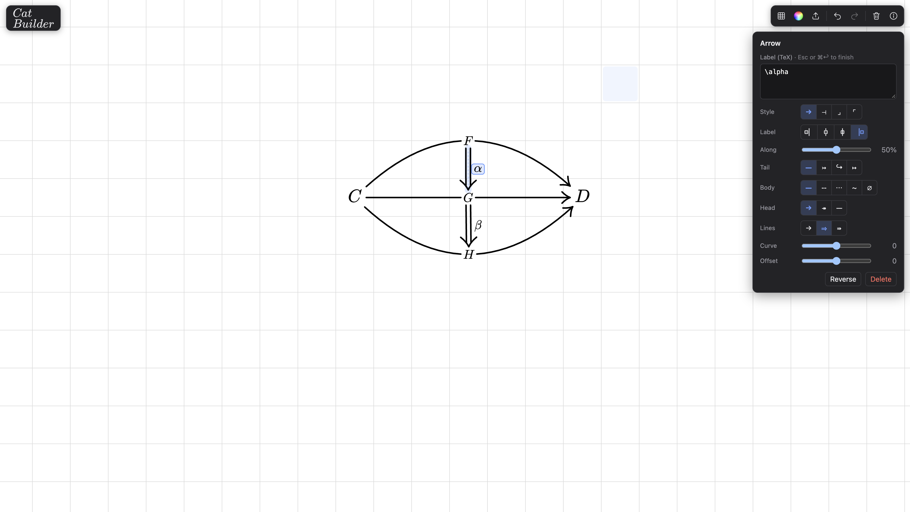
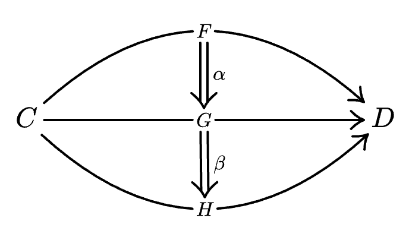

# Cat Builder

A lightweight Category Theory diagram editor. Diagrams export to SVG, PNG, WEBP, and embedded links
to share.

Credit to [Quiver](https://github.com/varkor/quiver), this project is entirely inspired by their
work.

Labels use MathJax, so latex-like syntax is supported and SVG export is a path, so no need for font
logistics.

## Demo

### Application



### Generated Diagram



## Gestures

| Gesture                                    | Action                                                         |
| ------------------------------------------ | -------------------------------------------------------------- |
| Click an empty square, then click it again | New object (a double-click works too, as in quiver)            |
| Drag from an object or arrow               | New arrow (release on an empty square to create the target)    |
| Drag from an object back onto itself       | Loop                                                           |
| ⌥/Alt-drag                                 | Move objects                                                   |
| Drag empty space                           | Box select (⇧ adds)                                            |
| Click / ⇧-click                            | Select / toggle (anywhere in an object's square selects it)    |
| Double-click a cell / Enter                | Edit its label                                                 |
| Esc / ⌘↩ (in the label)                    | Finish editing (Enter adds a line; newlines are just spacing)  |
| Tab (in the label)                         | Indent with four spaces (⇧Tab leaves the field)                |
| Arrow keys                                 | Nudge selected objects                                         |
| ⌫ / Delete                                 | Delete selection (and everything attached to it)               |
| ⌘Z / ⌘⇧Z                                   | Undo / redo                                                    |
| Scroll, space-drag, middle-drag            | Pan                                                            |
| Pinch, ⌘/Ctrl-scroll                       | Zoom                                                           |

## Development

```bash
bun install
bun dev          # dev server with HMR (src/index.ts)
bun test         # unit tests
bun run typecheck
bun run build    # static site in dist/ (host anywhere)
```

The app is entirely client-side; the Bun server only serves the bundle during development.
